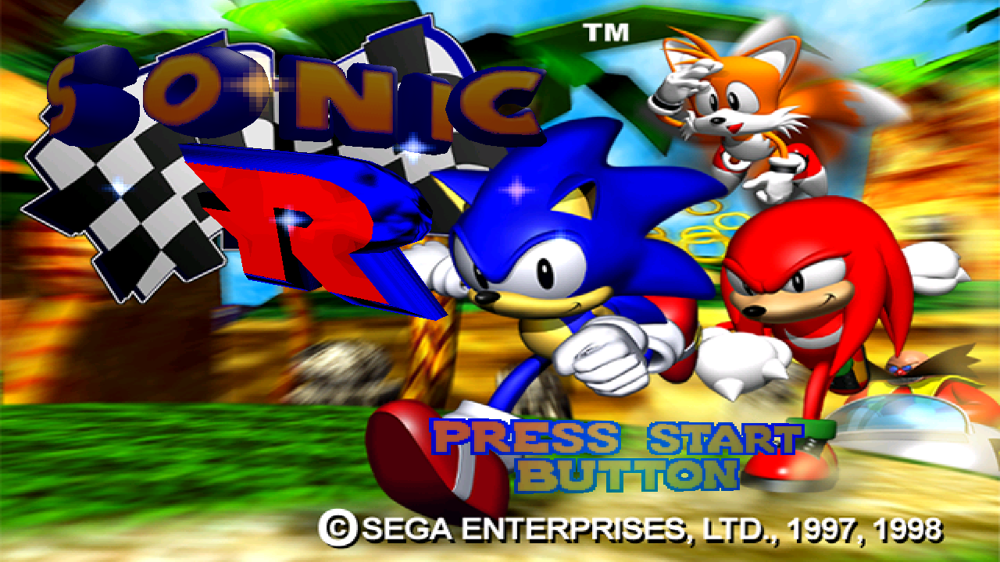
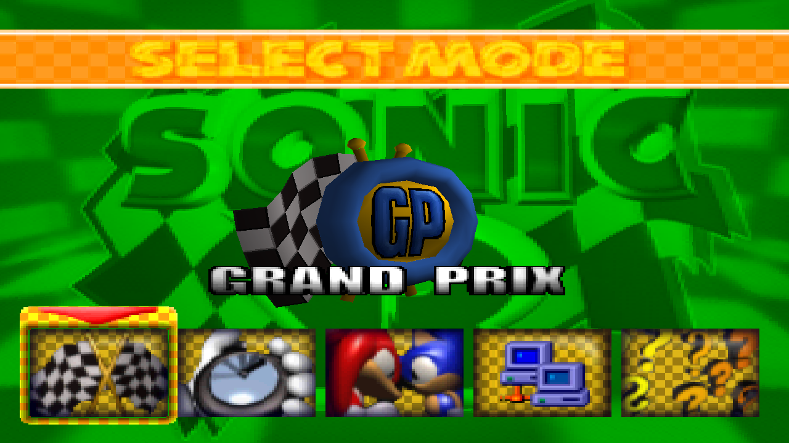
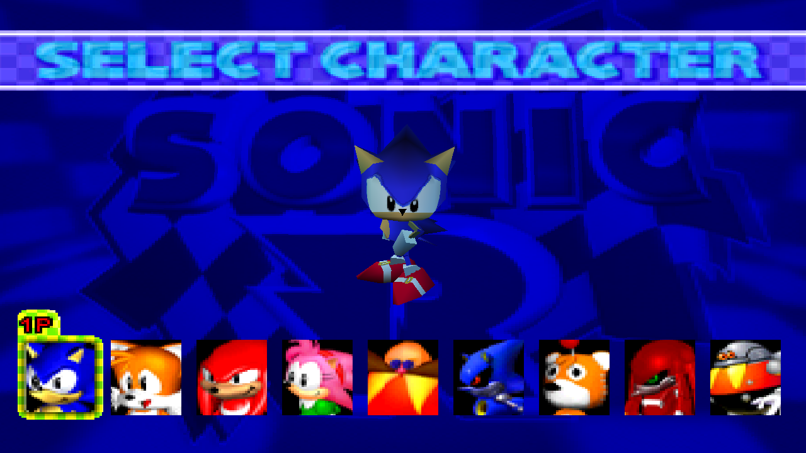
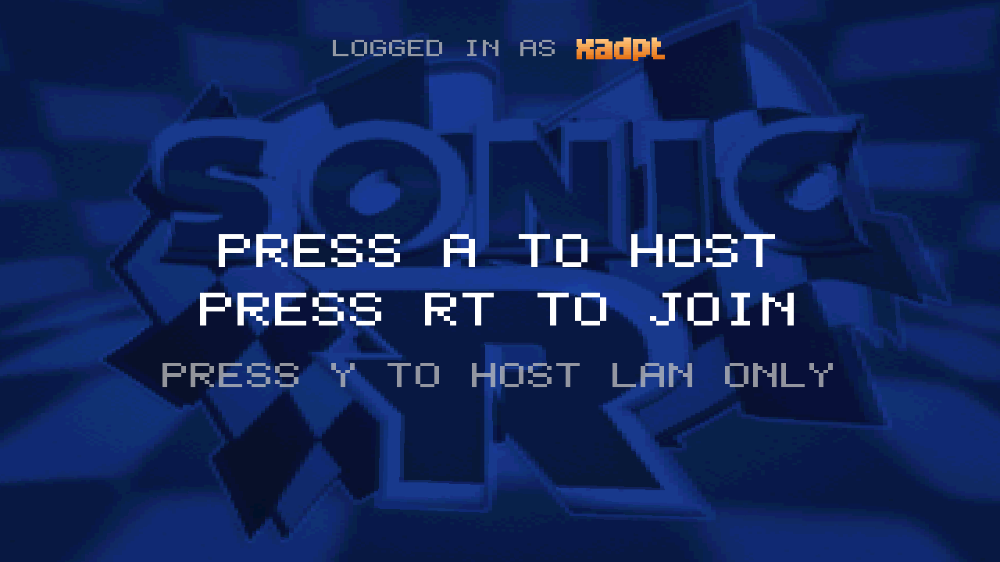
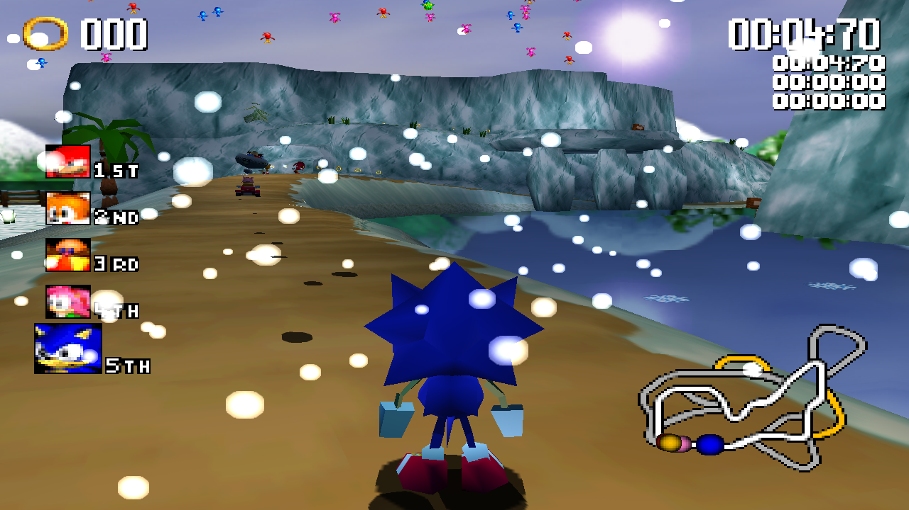
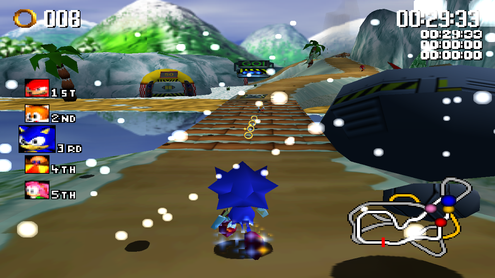
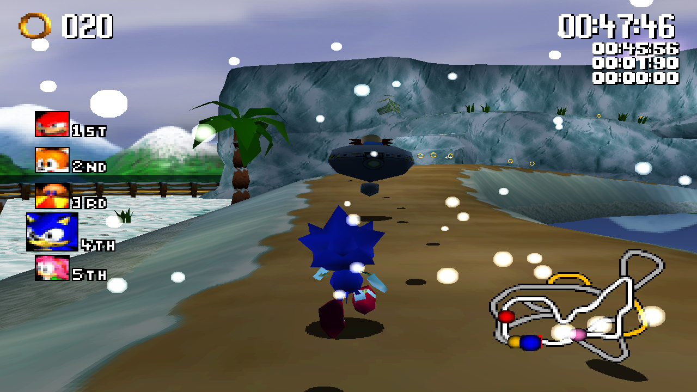
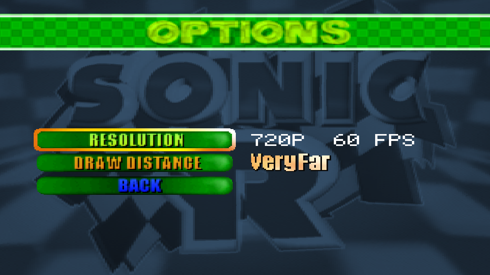

# Sonic R Xbox

A port of *Sonic R* (the 1998 Sega PC release) to the **original Xbox**, built on
[jnmartin84's decompilation](https://github.com/jnmartin84/sonic-r) of the
original executable and the [nxdk](https://github.com/XboxDev/nxdk) homebrew
toolchain. Tested on real hardware (component video, 480p and 720p).

> **This repository does not contain the game.** It is only the game engine. You
> must own Sonic R and supply its data (from the 1998 PC CD) yourself.

## Credits and authorship

- **Original game:** Traveller's Tales and Sonic Team, published by SEGA.
- **Decompilation and cross-platform engine:** [jnmartin84](https://github.com/jnmartin84/sonic-r),
  including the later upstream fixes merged here (30 fps options screens, jet flame,
  online balloon mode, network interpolation) and the Dreamcast bulk texture loaders.
- **PSP port:** [ghurone](https://github.com/ghurone/Sonic-R-PSP). Its 60 fps method and
  several fixes and its buffered file reading were studied and reimplemented for the Xbox.
- **Xbox port:** all of the code was written by **Claude** (Anthropic's AI, through Claude Code).
- **XadPT** did not program anything. XadPT gave Claude every instruction and
  direction for the port and tested everything that could be tested on a real
  original Xbox.
- Everyone else whose work this port stands on (nxdk and XboxDev, pbgl, SDL2,
  lwIP, BearSSL, libusbohci, the Reality Jump matchmaker and the Windows build
  tools) is listed in [docs/xbox.md](docs/xbox.md#credits).

This is a non-commercial preservation project, not affiliated with or endorsed
by Sega. Like the upstream project, it may be downloaded, built and modified,
but never sold. See [LICENSE](LICENSE).

## What the port does

- Runs the full game on an original Xbox: menus, all tracks and characters,
  split-screen for up to **4 players**, music and sound.
- **Faithful to the 1998 PC version.** Behaviour and visuals were compared with
  `SONICR.EXE` function by function, including fog, weather, water and sky
  details.
- **480p and 720p** (720p stretches the 4:3 picture to 16:9) and an optional
  **60 fps** mode (logic at 30 Hz, a halfway frame in between), selectable in
  Options > Graphics, plus a *Very Far* draw distance.
- **Online and LAN play** (up to 4 players), with a 5 second countdown before
  the race starts, and the race carrying on if a player leaves or loses
  connection.
- **Pause** works in online races (Start pauses, Quit leaves the session).
- **Full pad remapping**, including the triggers and Black button.
- **USB keyboard** support for the lobby chat (through a controller port
  adapter).
- Automatic saves in the dashboard-friendly `E:\UDATA\FFFF5352` folder.
- **SonicR-Music.exe**: a Windows tool that rips the music from your original CD
  (or converts WAV files) into the format the Xbox build reads.

## Screenshots

Captured on a real original Xbox (720p, 60 fps mode).

| | |
|---|---|
|  |  |
|  |  |
|  |  |
|  |  |

## Download

Get `SonicR-Xbox.zip` from the
[Releases](https://github.com/XadPT/sonic-r/releases) page. It contains
`default.xbe`, `SonicR-Music.exe`, the small `DATA` folder, the guides and the
license, but **no game data**.

## Requirements

- An original Xbox that can run homebrew (softmod or modchip), or xemu.
- Your own copy of the Sonic R PC CD (game data and music).
- Windows, only for `SonicR-Music.exe`.
- To build from source: nxdk with pbgl (see [docs/xbox.md](docs/xbox.md#building-from-source)).

## Quick start

1. Copy `GENERAL`, `ISLAND`, `CITY`, `RUIN`, `FACTORY`, `EMERALD`, `AI`, `BIN`
   and `SOUND` from the Sonic R CD into one folder.
2. Copy the release's `DATA` folder contents over them.
3. Run `SonicR-Music.exe` with the CD in the drive and put the resulting
   `MUSIC` folder next to `default.xbe`.
4. Copy the folder to the Xbox hard drive and launch `default.xbe`.

Everything is explained step by step in **[docs/xbox.md](docs/xbox.md)**:
install, music, controls, online play, video modes, saves, troubleshooting,
building and technical notes.

## How to build

Full details are in [docs/xbox.md](docs/xbox.md#building-from-source).

1. Install [nxdk](https://github.com/XboxDev/nxdk) and its prerequisites, and
   clone [pbgl](https://github.com/Ryzee119/pbgl) into `nxdk/lib/pbgl`.
2. Activate the toolchain and build:
   ```sh
   eval "$(nxdk/bin/activate -s)"
   make -C source/xbox NXDK_DIR=$PWD/nxdk -j8
   ```
3. The result is `source/xbox/bin/default.xbe`, with the title ID already
   stamped (needed so saves go to `E:\UDATA\FFFF5352`).
4. Build the music tool for Windows (optional):
   ```sh
   i686-w64-mingw32-gcc -O2 -static -s -o SonicR-Music.exe source/xbox/tools/sonicr_music/sonicr_music.c
   ```
5. Copy your game data, `MUSIC` and `default.xbe` to the Xbox (see Quick start).

## In game

- **Options > Controls** remaps the buttons. **Options > Graphics** sets
  resolution and draw distance.
- **Reset to dashboard:** hold L + R triggers + Back + Black for half a second.
- **Music:** `MUSIC\trackN.son` (raw PCM) or `MUSIC\trackN.adx` (about 3.5x smaller).
- **Diagnostics:** off by default. Put an empty `DEBUG.TXT` next to
  `default.xbe` to enable `SONICR.LOG` and the debug pad shortcuts when
  reporting a problem.

## Repository layout

- `source/sdl/` : the shared game code from the decompilation, with the Xbox
  changes.
- `source/xbox/` : the Xbox platform layer (video, audio, input, USB keyboard,
  network), the Makefile and the tools (`sonicr_music/`, title ID stamping).
- `DATA/` : the few small support files that go with the game data.
- `docs/` : the guides (`xbox.md`, plus the upstream `desktop.md` and
  `dreamcast.md`).
- `dreamcast/` : the upstream Dreamcast build files.

## Other platforms

The engine this port is based on also runs on Windows, macOS, Linux and the
Sega Dreamcast. See the upstream project and [docs/desktop.md](docs/desktop.md)
and [docs/dreamcast.md](docs/dreamcast.md).

## AI disclosure

The decompilation this port builds on is the product of months of
reverse-engineering and x86-to-C translation by jnmartin84 using Ghidra and
Claude Code, validated against the 1998 `SONICR.EXE` and playtested by Sonic R
fans. The Xbox port itself was written entirely by Claude and tested on real
hardware by XadPT. If this use of AI conflicts with your values, please leave
this page now.

## About

Sonic R (1998 PC) ported to the original Xbox, from jnmartin84's decompilation.
Topics: `xbox`, `original-xbox`, `nxdk`, `sonic`, `sonic-r`, `port`, `homebrew`.
